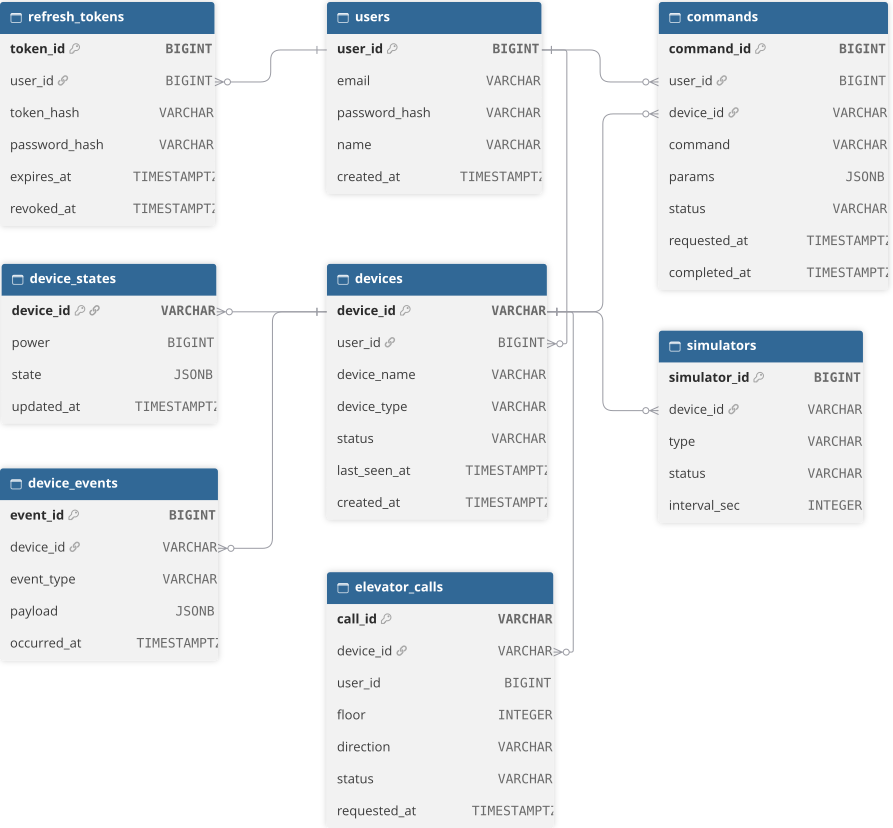
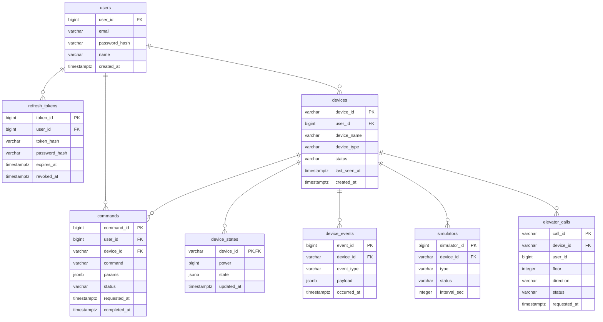

# ERD

[← README](../../README.md)

- 서비스마다 자기 DB를 가집니다. 다른 서비스의 DB는 직접 읽지 않고 API를 호출합니다
- 전체 그림: [Home_IoT_ERD.svg](Home_IoT_ERD.svg)

## 전체 테이블

## DB 테이블 변경 · 시드 데이터
| 항목 | 방법 |
|---|---|
| 테이블 변경 | <서비스 시작 때 생성 / migrations 스크립트> |
| 시드 데이터 | <scripts/seed 실행 방법> |